<h1 align="center">duckpond</h1>

<p align="center"></p>

<p align="center">Encrypted environment-variable profiles for Linux and macOS, written in Rust.</p>

> [!NOTE]
> AI disclosure: the code, the tests and the documentation of duckpond were written with Claude Opus, an AI model from Anthropic. Read the [Security notes](#security-notes) before you keep secrets that matter in it.

Keep environment variables in encrypted profiles. Load them into your shell, or run a
command with them, only when you need them.

## Why this project exists

duckpond exists because the other tools did not offer the features that its author needed.
It was written mainly for personal use. The code is public in case it is useful to someone
else too.

## Install

```sh
brew install al-bashkir/tools/duckpond
```

Or build from source:

```sh
cargo install --locked --path .
```

`--locked` builds the dependency versions in `Cargo.lock`, which CI tests and `cargo audit`
checks. Without it, cargo takes the newest compatible versions.

Or download a binary from the GitHub releases (Linux x86_64 and arm64 static, macOS arm64) and check
it against `SHA256SUMS`.

Needs `gpg` on `PATH` for GPG profiles. Linux and macOS.

With a terminal pinentry (curses or tty), gpg must know your terminal, else it fails with
`Inappropriate ioctl for device`. Put this in your shell rc (a GUI pinentry does not need it):

```sh
export GPG_TTY=$(tty)
```

## Shell setup

Add this to your shell rc file. For zsh, put it after `compinit`.

```sh
eval "$(duckpond init zsh)"      # or: bash
duckpond init fish | source      # fish
```

This gives you:

- `duckpond load` and `duckpond unload` that change the current shell. Without a profile
  name, they open a picker. Type to filter like fzf: the letters must come in that
  order, with any text between them, so `vadc1` finds `Vault DC1`.
- Tab completion of commands, flags and profile names. In zsh, a name with spaces
  completes in double quotes: `duckpond load "Addons Mozilla"`.

Tested with zsh, bash and fish 4.6.

## Usage

```sh
duckpond create work --gpg you@example.com   # GPG lock (no prompt if gpg-agent has the key)
duckpond create work --gpg                   # pick one of your GPG secret keys in a menu
duckpond create home                         # passphrase lock (asks twice)

duckpond set work GITHUB_TOKEN               # asks for the value, hidden
pass show gh | duckpond set work GITHUB_TOKEN    # or reads it from stdin
duckpond set work GITHUB_TOKEN --comment "CI bot" --expires 2027-01-31
duckpond set work GITHUB_TOKEN --keep-value --expires none

duckpond list                    # profile names
duckpond list work               # NAME / VALUE (masked) / EXPIRES / COMMENT
duckpond list work --reveal      # show values
duckpond get work GITHUB_TOKEN   # one value as it is: no quotes, no newline
duckpond get | wl-copy           # pick a profile, then a variable

duckpond load work               # load into this shell
duckpond load                    # pick a profile, then load it
duckpond unload work
duckpond launch work -- terraform plan
duckpond launch -- nvim          # pick a profile, then run nvim

duckpond import work .env        # merge a dotenv file (or - for stdin)
duckpond export work -o out.env  # dotenv, mode 0600; --force to replace
duckpond unset work OLD_VAR
duckpond delete work             # asks; --yes when there is no terminal
```

`--gpg` takes an optional value, so put it after the profile name: `create --gpg work`
reads `work` as the key. The menu shows only keys that can encrypt (not expired, revoked
or disabled), and the profile is locked to the fingerprint you choose.

Without `init`, use `eval "$(duckpond load work)"` in bash or zsh, and
`duckpond load work --shell fish | source` in fish. (The default output also loads safely
in fish, but `unload` needs `--shell fish` there.) `load` refuses to print to a terminal,
so secrets do not land in your scrollback by mistake.

## Storage

- Directory: `$DUCKPOND_DIR`, else `${XDG_DATA_HOME:-~/.local/share}/duckpond`. Mode 0700.
- One file per profile: `<name>.enc`, mode 0600. Writes are atomic (temp file, fsync, rename).
- The file is a GPG message or an age passphrase file. The lock type is read from the file.
- Inside the encryption: a JSON map of variables (value, comment, expiry). No keys,
  no passphrase, no recipients.
- Profile names are file names, so `list` and completion need no decryption.
  Variable names and values are only inside the encryption.

## Security notes

- Keep the store where only your account can write. Encryption keeps the values secret,
  but it does not prove that you wrote a profile file. Anyone with your GPG public key can
  write a GPG profile, and duckpond reads the lock type from the file, so such a file can
  also replace a passphrase profile. A changed file can set any variable, `PATH` and
  `LD_PRELOAD` too, so `load` and `launch` would run its code. A GPG profile is saved again
  to the keys listed in its file, and an old copy restored from a backup loads as it is.
  Do not put the store in a sync folder, a shared directory or a backup that someone else
  can change.
- Values never come from command-line arguments, so they do not reach shell history or `ps`.
- Prompts read and write `/dev/tty`. stdout carries only data, so `eval` never runs a prompt,
  a warning or an error message.
- `list` masks values unless you give `--reveal`. Control characters are shown escaped,
  so a value cannot send escape sequences to your terminal. `get`, and `export` without
  `-o`, refuse to print a value with control characters to a terminal; a pipe or a file
  gets it unchanged.
  Error messages show control characters escaped too, for example in a file name.
- Profile names allow only `A-Z a-z 0-9 space . _ @ + -`, start with a letter or digit,
  and contain no path separators.
- `DUCKPOND_PASSPHRASE` skips the passphrase prompt (for scripts). Other processes of
  your user can read the environment, so use it with care. `launch` removes it from the
  child's environment.
- `load` refuses a profile in which a variable that bash or zsh keeps as an integer
  (`OPTIND`, `HISTSIZE`, `SHLVL` and others) holds anything but a plain number. These shells
  evaluate such a value as arithmetic, and that can run commands. A variable that you
  declare as an integer in your own shell rc file is not on this list.
- Dotenv import/export is raw `NAME=value` per line (Docker `--env-file` rules: no quote
  removal). Export refuses values that contain line breaks.

## Glossary

- **profile**: a named, encrypted set of variables. One file in the store.
- **variable**: a name with a value, and an optional comment and expiry date.
- **lock**: how a profile is encrypted. `gpg` (to one or more keys) or `passphrase` (age).
- **store**: the directory that holds the profile files.

## License

MIT. See [LICENSE](LICENSE).
